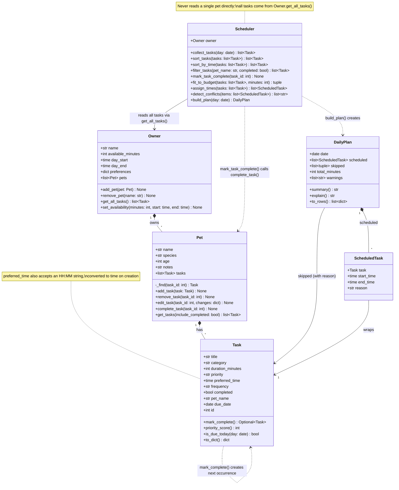

# PawPal+ (Module 2 Project)

**PawPal+** is a Streamlit app that helps a busy pet owner plan a day of care for all of their pets. You enter your pets, their care tasks and how much time you have. PawPal+ builds a schedule, warns you about clashes, and explains its choices.

## ✨ Features

- **Multi-pet planning:** one owner, any number of pets. The scheduler gathers every pet's tasks through `Owner.get_all_tasks()` and plans them together.
- **Sorting by time:** `Scheduler.sort_by_time()` lists tasks in clock order, with "any time" tasks last, using `sorted()` with a lambda key.
- **Priority-first planning:** `Scheduler.sort_tasks()` orders tasks by priority, then preferred time, then shortest first. `Scheduler.fit_to_budget()` then keeps tasks until your available minutes run out.
- **Filtering:** `Scheduler.filter_tasks(pet_name, completed)` shows one pet's tasks, open tasks, finished tasks, or any combination.
- **Smart time slots:** `Scheduler.assign_times()` pins tasks with a preferred time exactly there, and fits flexible tasks into the open gaps around them.
- **Conflict warnings:** `Scheduler.detect_conflicts()` flags any overlapping tasks, including exact same-time clashes. It says whether the clash is between two tasks of the same pet or of different pets, and also flags tasks that run past your day's end.
- **Daily and weekly recurrence:** `Scheduler.mark_task_complete()` marks a task done and automatically creates the next one, due tomorrow (daily) or in a week (weekly), calculated with `timedelta`. "once" tasks don't repeat.
- **Explained plans:** `DailyPlan.explain()` gives the reason for every scheduled task and every skipped one, such as "not enough time (45 min needed, 15 min left)".
- **Friendly input, safe defaults:** times can be typed as `"HH:MM"`, and a bad priority or a zero-minute task is rejected with a clear error.

## Scenario

A busy pet owner needs help staying consistent with pet care. They want an assistant that can:

- Track pet care tasks (walks, feeding, meds, enrichment, grooming, etc.)
- Consider constraints (time available, priority, owner preferences)
- Produce a daily plan and explain why it chose that plan

Your job is to design the system first (UML), then implement the logic in Python, then connect it to the Streamlit UI.

## What you will build

Your final app should:

- Let a user enter basic owner + pet info
- Let a user add/edit tasks (duration + priority at minimum)
- Generate a daily schedule/plan based on constraints and priorities
- Display the plan clearly (and ideally explain the reasoning)
- Include tests for the most important scheduling behaviors

## Getting started

### Setup

```bash
python -m venv .venv
source .venv/bin/activate  # Windows: .venv\Scripts\activate
pip install -r requirements.txt
```

### Run

```bash
streamlit run app.py   # the web app
python main.py         # command-line demo of the scheduler
python -m pytest       # the test suite
```

### Suggested workflow

1. Read the scenario carefully and identify requirements and edge cases.
2. Draft a UML diagram (classes, attributes, methods, relationships).
3. Convert UML into Python class stubs (no logic yet).
4. Implement scheduling logic in small increments.
5. Add tests to verify key behaviors.
6. Connect your logic to the Streamlit UI in `app.py`.
7. Refine UML so it matches what you actually built.

## 🧩 Implementation Summary

The backend lives in `pawpal_system.py` and is made of six dataclasses:

| Class | Role |
|---|---|
| `Task` | One care activity: title, duration, priority, optional preferred time, how often it repeats, due date, completed flag. Completing a daily or weekly task creates its next occurrence. |
| `Pet` | A pet's details plus its own list of tasks. Adds, edits, removes and completes tasks by id. |
| `Owner` | Holds the pets and the constraints (minutes available, day start and end). `get_all_tasks()` returns every pet's tasks in one list. |
| `Scheduler` | The "brain." Reads tasks only through `owner.get_all_tasks()`, so it plans across all pets at once. |
| `ScheduledTask` | A task placed at a start and end time, plus the reason it was placed there. |
| `DailyPlan` | The result: scheduled tasks, skipped tasks with reasons, and warnings. Can print a summary, explain itself, or turn into table rows. |

How a plan is built (`Scheduler.build_plan()`):

1. **Collect** every task from every pet that is due today and not completed.
2. **Sort** by priority (high first), then preferred time, then shortest first.
3. **Fit to budget** (`fit_to_budget`) by adding tasks until the time budget runs out. Tasks that don't fit are skipped with a reason. The budget is the smaller of the owner's available minutes and their day window.
4. **Assign times.** Tasks with a preferred time are pinned there; the rest fill the earliest open gaps from the start of the day.
5. **Detect conflicts** such as overlapping slots or tasks running past the end of the day, and report them as warnings.

`main.py` is a command-line demo of this flow, and `tests/test_pawpal.py` holds the pytest tests.

## 🏗️ Architecture

The final class diagram (source: [`diagrams/uml_final.mmd`](diagrams/uml_final.mmd)). The original Phase 1 draft is kept in [`diagrams/uml.mmd`](diagrams/uml.mmd) for comparison.



## 🖥️ Sample Output

Output of `python main.py` (owner Jordan with 90 minutes available, two pets, seven tasks added out of time order):

```text
== All tasks, sorted by time ==
  07:30  Breakfast          Mochi  [high] daily, due 2026-10-19
  08:00  Morning walk       Mochi  [high] daily, due 2026-10-19
  08:00  Thyroid pill       Luna   [high] daily, due 2026-10-19
  08:15  Flea treatment     Mochi  [high] once, due 2026-10-19
  18:30  Evening walk       Mochi  [medium] daily, due 2026-10-19
  --:--  Brushing           Mochi  [low] weekly, due 2026-10-19
  --:--  Clean litter box   Luna   [medium] daily, due 2026-10-19

== Filter: Luna's tasks ==
  --:--  Clean litter box   Luna   [medium] daily, due 2026-10-19
  08:00  Thyroid pill       Luna   [high] daily, due 2026-10-19

== Filter: completed ==
  07:30  Breakfast          Mochi  [high] daily, done

== Filter: Mochi, still open (note tomorrow's Breakfast) ==
  18:30  Evening walk       Mochi  [medium] daily, due 2026-10-19
  08:00  Morning walk       Mochi  [high] daily, due 2026-10-19
  08:15  Flea treatment     Mochi  [high] once, due 2026-10-19
  --:--  Brushing           Mochi  [low] weekly, due 2026-10-19
  07:30  Breakfast          Mochi  [high] daily, due 2026-10-20

Today's Schedule (2026-10-19) — 75 min planned
  07:00–07:10  Clean litter box (Luna) [medium]
  08:00–08:05  Thyroid pill (Luna) [high]
  08:00–08:30  Morning walk (Mochi) [high]
  08:15–08:20  Flea treatment (Mochi) [high]
  18:30–18:55  Evening walk (Mochi) [medium]

Why this plan:
  - Clean litter box: medium priority; placed in next open slot
  - Thyroid pill: high priority; at preferred time 08:00
  - Morning walk: high priority; at preferred time 08:00
  - Flea treatment: high priority; at preferred time 08:15
  - Evening walk: medium priority; at preferred time 18:30
  - SKIPPED Brushing (Mochi): not enough time (45 min needed, 15 min left)
  ! Conflict at 08:00: Thyroid pill and Morning walk overlap — different pets (Luna & Mochi)
  ! Conflict at 08:15: Morning walk and Flea treatment overlap — same pet (Mochi)
```

## 🧪 Testing PawPal+

Run the full test suite from the project folder:

```bash
# Run the full test suite:
python -m pytest

# Run with coverage (needs pytest-cov, which is in requirements.txt):
python -m pytest --cov=pawpal_system --cov-report=term-missing
```

`--cov=pawpal_system` measures just the backend module. `--cov-report=term-missing` lists the line numbers no test ran.

The 30 tests in `tests/test_pawpal.py` cover both normal use and edge cases:

- **Sorting:** tasks added out of order come back in clock order, untimed tasks go last, and a pet with no tasks gives an empty list.
- **Recurring tasks:**
  - completing a daily task creates a new one due tomorrow, with a new id and the same pet
  - weekly tasks come back in 7 days, and "once" tasks don't repeat
  - an overdue task comes back tomorrow, not still overdue
  - completed tasks and tomorrow's copy stay out of today's plan
- **Conflict detection:**
  - two tasks at the exact same time are flagged, for different pets and for the same pet
  - overlaps between tasks that aren't next to each other are caught
  - back-to-back tasks (08:00–08:30, then 08:30) are not flagged
- **Planning and time budget:**
  - flexible tasks are placed around tasks with a preferred time
  - high priority wins when time is short
  - a task that's too long is skipped while a shorter one still fits
  - an owner with no pets, or a pet with no tasks, doesn't break the plan
- **Basics and validation:**
  - completing a task changes its status, and adding a task increases the pet's task count
  - filtering works by pet and by status
  - bad priorities and unknown task ids raise clear errors
  - `"HH:MM"` strings are converted to times
- **Bookkeeping and output:**
  - editing, listing and removing tasks, and removing pets and changing availability
  - the plan's summary, explanation and table rows
  - the "runs past day end" warning

Sample test output:

```text
============================= test session starts ==============================
platform darwin -- Python 3.11.17, pytest-9.1.1, pluggy-1.7.0
rootdir: /Users/alexreifel/Coding Programs/CodePath AI 110/ai110-module2show-pawpal-starter
configfile: pytest.ini
testpaths: tests
plugins: cov-7.1.0, anyio-4.15.1, platformdirs-4.13.5
collected 30 items

tests/test_pawpal.py ..............................                      [100%]

============================== 30 passed in 0.02s ==============================
```

Coverage output (`python -m pytest --cov=pawpal_system --cov-report=term-missing`):

```text
================================ tests coverage ================================
______________ coverage: platform darwin, python 3.11.17-final-0 _______________

Name               Stmts   Miss  Cover   Missing
------------------------------------------------
pawpal_system.py     195      2    99%   208, 210
------------------------------------------------
TOTAL                195      2    99%
============================== 30 passed in 0.06s ==============================
```

The only uncovered lines are two in `DailyPlan.explain()` that print skipped tasks and warnings. Both of those lists are already tested directly through `plan.skipped` and `plan.warnings`.

**Confidence level: ★★★★☆ (4/5)**

All 30 tests pass, with 99% line coverage of `pawpal_system.py`. Together they cover each scheduling feature, plus the edge cases most likely to break: same-time conflicts, back-to-back boundaries, empty inputs, recurrence dates and the time budget. It's not 5 stars because:

- the Streamlit UI only has a manual smoke test, not automated tests
- the tests use the real current date, so cases like month or year rollovers aren't tested on purpose
- owner preferences aren't used by the scheduler yet
- conflicts are warned about but not automatically resolved

## 📐 Smarter Scheduling

| Feature | Method(s) | In one line |
|---------|-----------|-------------|
| Sorting by time | `Scheduler.sort_by_time()` | Clock order by preferred time; untimed tasks last |
| Planning order | `Scheduler.sort_tasks()` | Priority, then preferred time, then shortest first |
| Filtering | `Scheduler.filter_tasks()` | By pet name and/or completion status, across all pets |
| Time budget | `Scheduler.fit_to_budget()` | Greedily keeps tasks until the minutes run out; skipped tasks get a reason |
| Conflict detection | `Scheduler.detect_conflicts()` | Warns on overlapping durations, labeled same pet or different pets |
| Recurring tasks | `Task.mark_complete()`, `Pet.complete_task()`, `Scheduler.mark_task_complete()` | Completing a daily or weekly task creates the next one automatically |

### Sorting — `Scheduler.sort_by_time()`

Returns every task across all pets (or a list you pass in) in clock order. It uses `sorted()` with a lambda key, `(t.preferred_time is None, t.preferred_time)`. `False` sorts before `True`, so timed tasks come first and tasks with no time go last. Times can be given as `"HH:MM"` strings and are converted to `time` objects. Zero-padded `"HH:MM"` strings would also sort correctly as plain text, but `time` objects make the scheduling math simpler.

`Scheduler.sort_tasks()` is a separate ordering used for *planning*: high priority first, then preferred time, then shorter tasks.

### Filtering — `Scheduler.filter_tasks(pet_name=None, completed=None)`

Reads from `Owner.get_all_tasks()`, so it works across every pet. Each argument is optional, and `None` means "don't filter on this":

- `filter_tasks(pet_name="Luna")` returns all of Luna's tasks.
- `filter_tasks(completed=False)` returns every open task.
- `filter_tasks("Mochi", completed=False)` returns Mochi's open tasks.

`Scheduler.fit_to_budget()` is the scheduling filter. It keeps tasks in priority order while they fit the owner's time budget, and skips the rest with a reason such as `not enough time (45 min needed, 15 min left)`.

### Conflict detection — `Scheduler.detect_conflicts()`

Checks **overlapping durations**, not just identical start times, so a 08:00–08:30 walk and an 08:15 flea treatment conflict. Slots are sorted by start time. Each slot is compared with the later slots until one starts after it ends; past that point nothing can overlap. That catches every overlapping pair, including ones that aren't next to each other. Each warning names the pets involved:

```text
! Conflict at 08:00: Thyroid pill and Morning walk overlap — different pets (Luna & Mochi)
! Conflict at 08:15: Morning walk and Flea treatment overlap — same pet (Mochi)
```

Conflicts are reported, not auto-fixed. Tasks with a preferred time stay where the owner put them. It also warns if a task runs past the owner's end of day.

### Recurring tasks — `Task.mark_complete()` / `Scheduler.mark_task_complete()`

`Scheduler.mark_task_complete(task_id)` finds which pet owns the task and calls `Pet.complete_task()`. That calls `Task.mark_complete()`:

- **daily** creates a new copy due `today + timedelta(days=1)`
- **weekly** creates a new copy due `today + timedelta(days=7)`
- **once** is just marked done, with no new copy

The new copy gets a fresh id. Because the next date counts from today, an overdue task comes back tomorrow rather than still overdue.

## 📸 Demo Walkthrough

### What you can do in the app

| Section | Actions |
|---|---|
| **Owner** | Set your name, how many minutes you have today, and when your day starts and ends. |
| **Pets** | Add pets (name, species, age). Empty and duplicate names are rejected. |
| **Tasks** | Add a task for any pet: title, duration, priority, how often it repeats, and an optional preferred time. Mark a task complete. Browse the task list sorted by time, filtered by pet and by status (Open / Done / All). |
| **Today's Schedule** | Click **Generate schedule**. You get a summary line, any conflict warnings, the time-slotted plan as a table, any skipped tasks with the reason, and a "Why this plan?" explanation. |

### Example workflow

1. Run `streamlit run app.py`. In **Owner**, set *Minutes available today* to 90 and keep the day as 07:00–21:00.
2. In **Pets**, add **Mochi** (dog) and **Luna** (cat). Each appears in the pets table right away.
3. In **Tasks**, add Mochi's *Breakfast* (10 min, high, preferred 07:30) and *Morning walk* (30 min, high, preferred 08:00). Then add Luna's *Thyroid pill* (5 min, high, preferred 08:00).
4. The **Task list** shows all three in time order: 07:30 Breakfast, then the two 08:00 tasks. Set the **Pet** filter to *Luna* and only the Thyroid pill remains.
5. Click **Generate schedule**. A green banner says *Planned 3 tasks — 45 of 90 minutes.* Above the table, a yellow warning appears: *Conflict at 08:00: Thyroid pill and Morning walk overlap — different pets (Luna & Mochi)*, with a tip to move one task or ignore it if two people can help.
6. Back in **Tasks**, choose *Mochi — Breakfast* under **Mark a task complete** and click **Mark complete**. A banner shows *Done! Next 'Breakfast' is due* tomorrow. Set **Status** to *Done* to see the finished task. Breakfast no longer appears in today's schedule.

### How conflicts are shown, and why

Conflicts appear **before** the schedule table, as a **yellow warning rather than a red error**. Some overlaps are fine in real life; for example, two people might split the morning routine. Each warning names both tasks, both pets and the time, and gives the owner a next step. PawPal+ never moves a task you pinned to a time without asking.

### Key Scheduler behaviors on display

- **Sorting:** the task list is always in clock order (`sort_by_time`).
- **Filtering:** by pet and by status (`filter_tasks`).
- **Priority and time budget:** low-priority tasks are skipped first when time runs out, each with a reason (`fit_to_budget`).
- **Conflict warnings:** same pet or different pets (`detect_conflicts`).
- **Recurrence:** completing a daily task creates tomorrow's copy (`mark_task_complete`).

### CLI output

The same behaviors from `python main.py` (the full output, including the sorting and filtering sections, is under Sample Output above):

```text
Today's Schedule (2026-10-19) — 75 min planned
  07:00–07:10  Clean litter box (Luna) [medium]
  08:00–08:05  Thyroid pill (Luna) [high]
  08:00–08:30  Morning walk (Mochi) [high]
  08:15–08:20  Flea treatment (Mochi) [high]
  18:30–18:55  Evening walk (Mochi) [medium]

Why this plan:
  - Clean litter box: medium priority; placed in next open slot
  - Thyroid pill: high priority; at preferred time 08:00
  - Morning walk: high priority; at preferred time 08:00
  - Flea treatment: high priority; at preferred time 08:15
  - Evening walk: medium priority; at preferred time 18:30
  - SKIPPED Brushing (Mochi): not enough time (45 min needed, 15 min left)
  ! Conflict at 08:00: Thyroid pill and Morning walk overlap — different pets (Luna & Mochi)
  ! Conflict at 08:15: Morning walk and Flea treatment overlap — same pet (Mochi)
```
